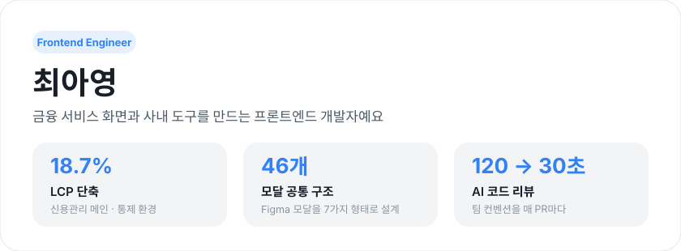

<picture>
  <source media="(prefers-color-scheme: dark)" srcset="./assets/header-dark.svg">
  
</picture>

 

### 지금 하는 일

핀다(Finda)에서 2024년 9월부터 프론트엔드 개발을 하고 있어요.
대출·신용·마이데이터 화면과 사내 백오피스를 만들었고, 지금은 신규 금융 서비스의 예·적금, 여신 화면을 만들고 있어요.

 

### 주요 경험

| | |
| :-- | :-- |
| **웹 성능 개선 TFT**  2026.02 ~ 2026.06 | 신용관리 메인을 App Router 스트리밍 SSR로 바꿔 LCP 2.62초 → 2.13초(18.7%), CLS 0 통제 환경 측정 |
| **신규 금융 서비스**  2026.08 ~ | 예·적금 가입·관리와 여신 화면 개발, Figma 모달 46개를 7가지 형태로 나눠 공통 구조 설계 |
| **사내 백오피스**  2024.11 ~ 2026.08 | ISMS 대응 인증 체계를 운영 중단 없이 Keycloak으로 단계 전환, 외부 CRM을 대신할 쿼리 빌더 개발 |
| **업무 자동화**  2025.02 ~ | 팀 컨벤션을 매 PR마다 적용하는 AI 코드 리뷰(120초 → 30초), 사내 문서를 찾아 답하는 슬랙 챗봇 |

 

### 프로젝트

회사 코드는 비공개라 개인 프로젝트만 올려 두었어요.

- [**ayoung-portfolio**](https://github.com/AYoungChoi-spec/ayoung-portfolio) · 경력기술서와 포트폴리오를 한 화면에서 보는 웹
- [**cockCockSport**](https://github.com/AYoungChoi-spec/cockCockSport) · 배드민턴 브랜드 쇼핑몰 웹
- [**고등학교 프로젝트**](https://github.com/chldkduds2) · Smarteen App+ Challenge 최우수상, SW마이스터고 연합 해커톤 수상작

 

### 기술

TypeScript · React · Next.js (App Router · RSC · Streaming SSR) · TanStack Query · Zustand · Tailwind CSS · MSW · Sentry

 

### 연락

choiayoungdev@gmail.com · [Blog](https://velog.io/@ayoung_dev/posts)
